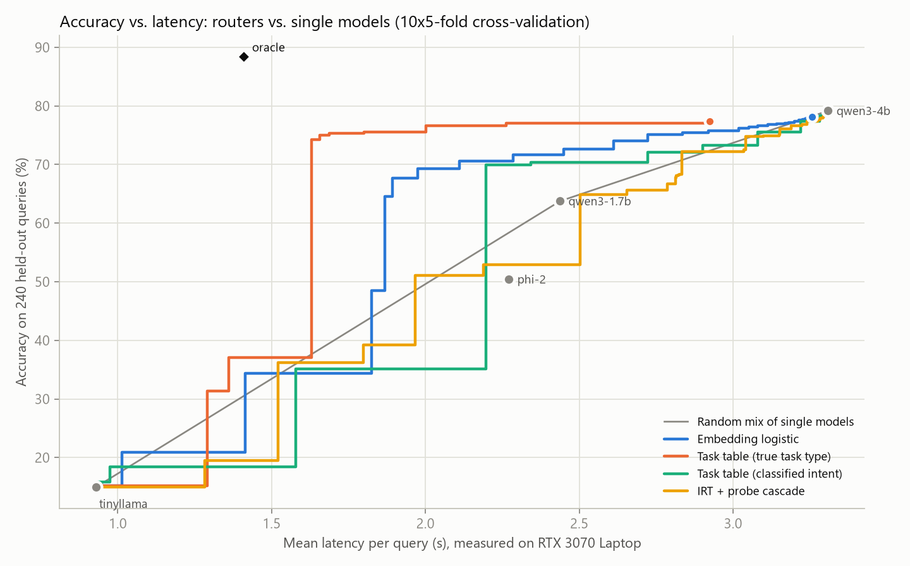

# Intent-Aware Model Routing Engine

A FastAPI service that sends each query to one of several local open-source LLMs and runs it there through [Ollama](https://ollama.com). In production, a keyword and TF-IDF intent classifier plus measured free VRAM and RAM decide which model answers, and every response reports its routing time, time to first token, tokens/s and total latency. A research track asks whether a router learned from measured outcomes can predict which local model will answer a query correctly, and whether it beats simply mixing single models on the accuracy and latency frontier. On 240 auto-graded queries and four local models, one learned router (logistic regression on query embeddings) beats random mixing with a 95% confidence interval above zero, but no router beats always calling the strongest model, the probe cascade does not pay off, and knowing the true task type would help more than any learned router.

## Status

- The production router works end to end on Ollama. With the trained router in `results/router/router.json` it uses the learned policy by default (`ROUTER_POLICY=legacy` restores the original intent policy).
- The learned routing research pipeline is built and tested: evaluation set, answer checkers, outcome collector, routing policies, offline analysis, live serving and live checks.
- Results below cover four models with all 240 items each (tinyllama, qwen3-1.7b, phi-2, qwen3-4b). Mistral-7B is excluded: its collection is incomplete (113 of 240 items), stopped early because on the throttled laptop GPU each Mistral query was taking tens of seconds.

## Learned routing research

### The question

Can a router predict which local model will answer a query correctly, and use that to beat simply mixing single models on the accuracy and latency frontier? Recent work reports that many learned routers converge to similar accuracy well below an oracle, and that task type explains most of the routing gap. This project tests those claims on small models running locally, where per-token log-probabilities and real latency are available, and adds a probe cascade that reads the small model's first tokens before deciding to escalate.

### Evaluation set

240 items, each checked automatically (`research/data/*.jsonl`, with per-item metadata in `research/data/item_meta.jsonl`):

| Source | Items | Task type | Token budget | License |
|---|---:|---|---:|---|
| GSM8K test | 60 | math | 384 | MIT |
| MBPP sanitized test split | 60 | code | 384 | CC BY 4.0 |
| MMLU test split | 60 | knowledge (34 subjects) | 256 | MIT |
| Hand-written (`research/build_custom.py`) | 60 | 20 instruction following, 20 specialized NLP tasks, 20 business-rule reasoning | 256 | this repo |

- `research/fetch_benchmarks.py` draws fixed-seed samples (seed 2026), so re-running reproduces the same items. GSM8K comes from github.com/openai/grade-school-math; MBPP and MMLU come through the Hugging Face datasets-server API.
- Every hand-written item carries a reference answer that must pass its own checker, and 9 of the 11 numeric items note the arithmetic behind their answer. `tests/test_research.py` checks that every reference answer passes its checker, and that every MBPP reference solution passes its own tests.

### Models

| Registry name | Ollama tag | Parameters (Ollama) | Quantization | Notes |
|---|---|---|---|---|
| tinyllama | `tinyllama` | 1B | Q4_0 | |
| qwen3-1.7b | `qwen3:1.7b` | 2.0B | Q4_K_M | hybrid model, thinking switched off (`think=False`) |
| phi-2 | `phi` | 3B | Q4_0 | |
| qwen3-4b | `qwen3:4b-instruct-2507-q4_K_M` | 4.0B | Q4_K_M | non-thinking Instruct 2507 build |
| mistral-7b | `mistral` | 7.2B | Q4_K_M | |

The plain `qwen3:4b` tag now points to the thinking-only 2507 release, which ignores `think=false` and spent its whole token budget reasoning without reaching an answer. Its first 72 records were therefore invalid and are excluded from the analysis, and the registry uses the Instruct 2507 build (commit d188a37). Query embeddings come from `all-minilm` through Ollama.

### Collection

`research/collect.py` runs every item on every model (5 x 240 = 1,200 records):

- Each query goes through the production prompt path: the `PromptManager` system prompt for the intent the production classifier assigns, then Ollama `/api/chat`.
- Per item it records the `all-minilm` query embedding, the production intent and the legacy router's choice.
- Per (item, model) pair it records correctness, measured latency, time to first token, Ollama's timing fields, and per-token log-probabilities (top 5) with their arrival times.
- Temperature 0 and seed 0. The run is resumable: finished (item, model) pairs are skipped. `research/run_collect.ps1` wraps it in its own window with a progress bar and a log.

### Answer checkers and the code sandbox

`research/checks.py` scores each answer by type: numbers (the value after the last "Answer:" marker, else the last number), multiple-choice letters, labels, label sequences, ordered extraction, JSON keys or values, text constraints (line counts, word limits, required and forbidden words, line prefixes), and Python code run against the item's tests.

Model-written code runs in a separate child interpreter: `python -I -B`, an empty temporary working directory, a 10 second timeout, and an audit hook that blocks file writes, file and directory removal or renaming, process creation (`subprocess.Popen`, `os.system`, `os.exec`, `os.spawn`, `os.startfile`), network access (`socket.connect`, `socket.bind`, `socket.getaddrinfo`, `urllib.Request`, `http.client.connect`), `ctypes` loading and calls, `input()`, and registry writes. An audit hook is a best-effort guard against accidental side effects, not a security boundary.

### Routing policies

Every policy in `src/routing_policies.py` estimates, for each query, the probability that each model answers it correctly, and the router picks

```
argmax_m  p_m(query) - lam * cost_m
```

where `cost_m` is the model's mean measured latency divided by the slowest model's. `lam = 0` means "most likely correct"; larger values trade accuracy for speed.

| Estimator | What it uses | Line of work |
|---|---|---|
| `GlobalPrior` | each model's overall accuracy (no routing signal) | baseline |
| `TaskTable` | accuracy per classified intent, or per true task type as an upper bound | "Most of the LLM Routing Gap Is Task Type" (2026) |
| `KNNRouter` | mean outcome of the 10 nearest training queries in embedding space | "When Simple kNN Beats Complex Learned Routers" (2025) |
| `EmbedLogReg` | one scikit-learn `LogisticRegression` per model on the query embedding | learned classifiers, e.g. RouteLLM (2024) |
| `IRTRouter` | item response theory, 1-D and 4-D | IRT-Router (ACL 2025) |

**IRT model.** A latent factor model: `logit P(model m correct on query q) = a_q . theta_m - b_q`, where the difficulty `b_q = x_q . w_b + c_b` and the discrimination `a_q = softplus(x_q W_a + c_a)` come from the query embedding `x_q`, and `theta_m` is the model's ability. The gradients are derived by hand and Adam is implemented in NumPy; `tests/test_routing_policies.py::test_irt_gradients_match_finite_differences` checks them against finite differences. Difficulty is reported as `b_q / |a_q|`, the ability at which P(correct) = 0.5, so abilities and difficulties share one scale.

**Probe cascade.** The small model starts answering. After its first k tokens, a logistic model (`ProbeModel`) estimates P(small model correct) from those tokens' log-probability features (mean, minimum, share below -1, mean top-1 to top-2 margin, mean entropy over the top 5) plus the router's prior. If the estimate falls below a threshold, the small model's stream is aborted and the large model answers. `crc_threshold` sets that threshold by conformal risk control (Angelopoulos et al.). Its loss is accuracy lost relative to always using the large model, not the overall error rate: a query counts as a loss when the cascade is wrong where the large model alone would be right.

### Evaluation protocol

`research/analyze.py` evaluates offline by looking up each chosen model's real outcome and real measured latency in the collected records.

- **Held-out scoring.** Every learned policy is scored only on queries it was not trained on: repeated R x 5-fold cross-validation (R = 10 by default), stratified by task type.
- **Frontiers.** Each policy is swept over 60 values of `lam` (0, then 59 values spaced geometrically from 0.002 to 4) to give an accuracy against latency curve. Its Pareto envelope is compared with the upper hull of randomly mixing single models, which any useful router must beat.
- **Summary metric.** Area under the envelope over the latency range from the fastest model to the most accurate model, that is, mean accuracy over that range of latency budgets.
- **Uncertainty.** A paired item bootstrap (500 draws, each also picking a random cross-validation repeat) gives confidence intervals for differences between policies.
- **Probe cascade.** Probe lengths k of 8, 16 and 32 are evaluated; the deployed default is k = 16. Cascade costs use measured probe times plus the large model's time.
- **Conformal study.** The probe is trained on 50% of items, the threshold is calibrated on 25%, and realized loss is measured on the remaining 25%, over 100 random splits, for risk levels 0.05 and 0.10. The deployed threshold uses 0.05.
- **Outputs.** `results/router_eval.json`, accuracy against latency plots (`results/router_frontier_light.png`, `results/router_frontier_dark.png`) and the deployable router `results/router/router.json`.

### Serving and live check

`src/learned_router.py` loads `results/router/router.json`, embeds the query with `all-minilm`, applies the decision rule over the models that are currently available, and returns a cascade plan when the pick is the cascade's small model. The model manager then streams the small model with log-probabilities, scores the first k tokens, and either keeps the answer or aborts the stream and runs the large model; the response's `metrics.cascade` reports what happened. If embedding fails, routing falls back to the original intent policy. `ROUTER_POLICY=legacy` turns the learned policy off.

`research/live_check.py` runs a stratified sample of evaluation items (6 per task type by default) through the live learned router on Ollama, with a real aborted stream when the cascade escalates, and compares the result with what `analyze.py` simulated: routing overhead, chosen model, escalation, correctness and latency.

### Reproduce

Pull the research models first:

```bash
ollama pull qwen3:1.7b
ollama pull qwen3:4b-instruct-2507-q4_K_M
ollama pull all-minilm
```

```bash
python -m research.fetch_benchmarks        # GSM8K, MBPP, MMLU samples (already in research/data)
python -m research.build_custom            # the 60 hand-written items (already in research/data)
python -m research.collect --run main      # or: pwsh -File research/run_collect.ps1 -Run main
python -m research.analyze --run main --models tinyllama qwen3-1.7b phi-2 qwen3-4b
python -m research.live_check --run main   # live router against the simulation
python -m research.eviction_check          # which models Ollama keeps resident, and reload cost
python -m research.report_tables           # the tables below, from results/*.json
```

`pwsh -File research/run_analyze.ps1 -Run main -Models tinyllama,qwen3-1.7b,phi-2,qwen3-4b` runs the analysis, the three live checks and the residency check in one window.

### Results

Four models, 240 items each, scored by 10 x 5-fold cross-validation (every number below is for queries the router was not trained on, except where marked descriptive). Every figure is printed by `python -m research.report_tables` from [`results/router_eval.json`](results/router_eval.json) and the live check files. Accuracies and gains are rounded down, latencies rounded up, and confidence intervals rounded outward. Latencies were measured on the same throttled laptop GPU as the benchmarks below, so treat them as relative, not absolute.

<picture>
  <source media="(prefers-color-scheme: dark)" srcset="results/router_frontier_dark.png">
  
</picture>

**Single models.**

| Model | Correct of 240 | Accuracy | Mean latency | business rules | code | instruction | knowledge | math | specialized |
|---|---:|---:|---:|---:|---:|---:|---:|---:|---:|
| tinyllama | 36 | 15.0% | 0.94 s | 25.0% | 11.6% | 15.0% | 20.0% | 1.6% | 40.0% |
| qwen3-1.7b | 153 | 63.7% | 2.44 s | 75.0% | 61.6% | 80.0% | 46.6% | 70.0% | 75.0% |
| phi-2 | 121 | 50.4% | 2.28 s | 50.0% | 35.0% | 50.0% | 61.6% | 41.6% | 90.0% |
| qwen3-4b | 190 | 79.1% | 3.31 s | 90.0% | 86.6% | 90.0% | 61.6% | 75.0% | 100.0% |

An oracle that picks the cheapest model that answers correctly reaches 88.3% at 1.41 s, so the gap a router could close is real.

**Routing policies.** AUC is mean accuracy over latency budgets from the fastest model (0.94 s) to the most accurate (3.31 s); the random mix of single models scores 0.5111.

| Policy | AUC | AUC minus random mix | 95% interval vs random mix | 95% interval vs intent table | Accuracy at qwen3-1.7b latency | Best accuracy |
|---|---:|---:|---:|---:|---:|---:|
| Embedding logistic | 0.5506 | +0.0394 | [+0.006, +0.084] | [+0.024, +0.114] | 71.6% | 78.1% |
| IRT 4-D | 0.5398 | +0.0286 | [-0.014, +0.072] | [+0.004, +0.109] | 68.3% | 76.4% |
| kNN (k=10) | 0.5125 | +0.0013 | [-0.038, +0.041] | [-0.023, +0.082] | 67.4% | 76.6% |
| IRT 1-D | 0.4855 | -0.0257 | [-0.065, +0.010] | [-0.044, +0.050] | 58.3% | 79.1% |
| Task table (classified intent) | 0.4787 | -0.0325 | [-0.074, +0.020] | n/a | 70.3% | 79.1% |
| Task table (true task type) | 0.6144 | +0.1032 | n/a | n/a | 77.0% | 77.3% |
| IRT + probe cascade | 0.4685 | -0.0427 | n/a | n/a | 52.9% | 79.1% |
| Cascade tinyllama to qwen3-4b (k=16) | 0.3487 | -0.1624 | n/a | n/a | 31.4% | 79.1% |
| Cascade qwen3-1.7b to qwen3-4b (k=16) | 0.2446 | -0.2666 | n/a | n/a | 63.7% | 79.1% |
| Cascade phi-2 to qwen3-4b (k=16) | 0.2525 | -0.2587 | n/a | n/a | 54.7% | 79.1% |

What this shows:

- **One learned router beats random mixing, and none beats the best model.** Logistic regression on the query embedding is the only policy whose interval against random mixing excludes zero. At qwen3-1.7b's latency budget it reaches 71.6% against qwen3-1.7b's 63.7%, and at phi-2's budget 70.5% against phi-2's 50.4%. No policy reaches qwen3-4b's 79.1% at a lower latency, so the deployed router, chosen by the rule "lowest latency that matches the best single model, else the most accurate setting", runs at lambda 0 and sends nearly every query to qwen3-4b. `ROUTER_LAMBDA` selects other points on the curve.
- **Task type carries most of the routing signal, and the production classifier misses it.** A table keyed on the true task type has the highest AUC of all (+0.1032 over random mixing), in line with recent work that attributes most of the routing gap to task type. The same table keyed on the production classifier's label falls below random mixing. The classifier labels 13 of 20 business-rule prompts and 8 of 20 instruction prompts as code generation.
- **kNN and IRT do not beat random mixing here.** kNN sits on the random-mix line. 4-D IRT beats the intent table but its interval against random mixing includes zero; 1-D IRT does neither. With 240 queries, many of these differences are within noise.
- **The probe cascade does not pay off.** Every cascade sits below random mixing. tinyllama is too weak (15.0%) for its early tokens to save much, and phi-2 (2.28 s) and qwen3-1.7b (2.44 s) are not much cheaper than qwen3-4b (3.31 s), so probing then escalating costs more than it saves.
- **The conformal guarantee held, at the expected price.** Calibrating the tinyllama to qwen3-4b escalation threshold for a 0.05 risk of lost accuracy gave a mean realized loss of 0.045 over 100 held-out splits (0.094 at a 0.10 target). Risk control bounds the mean, not every split: 28% and 31% of splits exceeded their target. To stay within the bound the cascade escalated 93% and 87% of queries, saving 0.5% and 5.4% of latency.

**Query difficulty (descriptive, IRT fit on all items).** Model abilities, centered: tinyllama -1.54, phi-2 -0.07, qwen3-1.7b 0.44, qwen3-4b 1.16, the same order as their accuracies. Mean difficulty on the same scale is lowest for specialized tasks (-1.01) and highest for knowledge (0.21); difficulty and prompt length have a Spearman correlation of 0.47. At the mid-frontier operating point (embedding logistic, lambda 0.5602, 70.5% accuracy at 2.12 s), the share of queries sent to qwen3-4b is 25% for the easiest fifth by difficulty and 43% to 46% for the other four fifths, so harder queries do go to the larger model, but the trend is mostly the easiest fifth against the rest.

**Live checks.** `research/live_check.py` ran 36 items (6 per task type) through the live router on Ollama, three times:

| Run | lambda | Routing p50 | Routing p90 | Same model as simulation | Cascades planned | Escalated live | Same correctness as recorded | Identical text | Median latency live | Median simulated |
|---|---:|---:|---:|---:|---:|---:|---:|---:|---:|---:|
| deployed | 0 | 36.2 ms | 54.6 ms | 36 of 36 | 0 | 0 | 32 of 36 | 17 of 36 | 1156 ms | 1207 ms |
| mid-frontier | 0.5602 | 32.7 ms | 48.7 ms | 36 of 36 | 0 | 0 | 32 of 36 | 18 of 36 | 1645 ms | 886 ms |
| cascade forced | 50 | 39.2 ms | 75.6 ms | 34 of 36 | 36 | 34 | 32 of 36 | 18 of 36 | 2955 ms | 1760 ms |

- **Routing overhead.** The learned router's median overhead is 32.7 ms to 39.2 ms, mostly the embedding call, against about 1.5 ms to 1.9 ms for the intent router in the benchmarks below.
- **Decisions match the simulation.** The live router chose the simulated model on every item, and in the forced cascade run the live probe agreed with the simulated escalation decision on 34 of 36 items (34 live escalations).
- **Outputs are not exactly reproducible.** Despite temperature 0 and a fixed seed, only 17 or 18 of 36 answers were identical to the recorded text, and correctness matched on 32 of 36 in each run.
- **Live latency can exceed the simulation.** At the mid-frontier point the live median was 1645 ms against 886 ms simulated. `research/eviction_check.py` measured one cause ([`results/ollama_eviction_check.json`](results/ollama_eviction_check.json)): Ollama kept at most 3 models resident, so with the embedding model loaded, routing among three LLMs forced reloads of 3.9 s to 8.1 s. The simulation, built from runs where each model ran alone, does not model this. The gap in the forced cascade run is not yet explained; the GPU's thermal state was not logged during the live checks.

## Production router

### How it routes

- **Intent classes:** code generation, creative writing, general reasoning, custom reasoning, conversation, specialized tasks, multi-intent. `src/intent_classifier.py` combines keyword rules with a TF-IDF and Multinomial Naive Bayes classifier.
- **Selection:** `src/routing_engine.py` scores the models whose capabilities match the intent, then keeps only models that fit current resources. With a GPU, a model fits if its measured VRAM footprint fits in free VRAM plus the VRAM held by models Ollama can evict, read through NVML (with an `nvidia-smi` fallback) and Ollama's `/api/ps`. Without a GPU, free RAM is checked instead. If nothing matches the intent, it falls back to an available model.
- **Inference:** `src/backends.py` runs the chosen model through Ollama's streaming `/api/chat` and returns the text with Ollama's timing fields and the client-measured time to first token. A mock backend with canned responses serves tests, and the app falls back to it, with a warning in the logs and in `/status`, when Ollama is not reachable.
- **Model management:** loading, unloading and LRU caching through Ollama's `keep_alive` and `/api/ps`.

### Models in the registry

| Registry name | Ollama tag | Status |
|---|---|---|
| `tinyllama` | `tinyllama` (1.1B, Q4_0) | runs on Ollama |
| `phi-2` | `phi` (2.7B, Q4_0) | runs on Ollama |
| `mistral-7b` | `mistral` (7.2B, Q4_K_M) | runs on Ollama |
| `qwen3-1.7b` | `qwen3:1.7b` | research model: no hand-set capabilities, selected only by the learned policy |
| `qwen3-4b` | `qwen3:4b-instruct-2507-q4_K_M` | research model: no hand-set capabilities, selected only by the learned policy |
| `llama-2-7b` | none | listed but disabled: not pulled, duplicates Mistral-7B |
| `llama-2-13b` | none | listed but disabled: a 13B model does not fit in 8 GB of VRAM |
| `business-logic-engine` | none | non-LLM placeholder: only the mock backend runs it (canned text) |
| `domain-expert-engine` | none | non-LLM placeholder: only the mock backend runs it (canned text) |

Disabled and placeholder entries are reported as unavailable (with a reason) on the Ollama backend, so the router never selects them.

**Custom reasoning.** The two custom reasoning engines are placeholders with no model behind them. Only the mock backend runs them, returning canned text; on Ollama they are unavailable, and `custom_reasoning` queries fall back to an available LLM, which the routing reasoning string states.

### Architecture

```
┌─────────────────┐    ┌─────────────────┐    ┌─────────────────┐
│   Query Input   │───>│ Intent Classifier│───>│ Routing Engine  │
└─────────────────┘    └─────────────────┘    └─────────────────┘
                                                       │
┌─────────────────┐    ┌─────────────────┐    ┌─────────────────┐
│  Model Registry │<───│ Model Manager   │<───│ Selected Model  │
└─────────────────┘    └─────────────────┘    └─────────────────┘
                                                       │
┌─────────────────┐    ┌─────────────────┐    ┌─────────────────┐
│ Prompt Manager  │<───│ Response Output │<───│ Model Processing│
└─────────────────┘    └─────────────────┘    └─────────────────┘
```

### Installation

Prerequisites:
- Python 3.10+ (tested on 3.12.5)
- [Ollama](https://ollama.com) for real inference, with the models pulled: `ollama pull tinyllama`, `ollama pull phi`, `ollama pull mistral` (about 6.6 GB on disk). The research track also needs the three models listed under [Reproduce](#reproduce) (about 3.9 GB).
- An NVIDIA GPU with 8 GB of VRAM runs all three production models fully on the GPU; without one, Ollama runs them on the CPU.
- Without Ollama the app still runs, on the mock backend (canned responses).

```bash
git clone https://github.com/mayankpm/Intent-Aware-Model-Routing-Engine.git
cd Intent-Aware-Model-Routing-Engine
python -m venv .venv
.venv/Scripts/activate        # Windows; on Linux/macOS: source .venv/bin/activate
pip install -r requirements.txt
```

Run with Ollama:

```bash
ROUTER_BACKEND=ollama uvicorn src.main:app --port 8000
# PowerShell: $env:ROUTER_BACKEND="ollama"; uvicorn src.main:app --port 8000
```

or `python run.py`. The API is at http://localhost:8000, with interactive docs at `/docs`. `/status` shows which backend is active, and each routing decision names its policy.

### Usage

```bash
curl -s -X POST http://localhost:8000/query -H "Content-Type: application/json" \
  -d '{"query": "Write a Python function to reverse a linked list", "max_tokens": 128}'
```

The response names the model that ran and its measured metrics:

```json
{
  "response": "...",
  "model_used": "qwen3-4b",
  "intent_classified": "code_generation",
  "metrics": {
    "backend": "ollama", "backend_model": "qwen3:4b-instruct-2507-q4_K_M",
    "routing_time_ms": ..., "time_to_first_token_ms": ..., "prompt_eval_ms": ...,
    "completion_tokens": ..., "tokens_per_second": ..., "total_latency_ms": ...
  },
  "routing_decision": {"selected_model": "qwen3-4b", "policy": "learned:Embedding logistic", "reasoning": "...", ...}
}
```

Optional request fields: `force_model` (skip selection, e.g. `"mistral-7b"`), `max_tokens`, `temperature`, `context`.

`python test_demo.py` exercises a running server and prints the backend, model and metrics for each query.

### API endpoints

| Method and path | Purpose |
|---|---|
| `POST /query` | route and answer a query |
| `POST /test-query` | the same, with a compact response |
| `POST /classify-intent` | intent classification only |
| `GET /` | basic service info |
| `GET /status` | backend, resources, available and unavailable models, statistics |
| `GET /models`, `GET /models/{model_name}` | registry entries and availability |
| `GET /routing-stats` | routing decision statistics |
| `GET /performance-stats` | latency, time to first token and tokens/s, overall and per model |

### Configuration

| Variable | Default | Meaning |
|---|---|---|
| `ROUTER_BACKEND` | `ollama` | `ollama` (falls back to mock if unreachable) or `mock` |
| `OLLAMA_HOST_URL` | `http://127.0.0.1:11434` | Ollama server |
| `ROUTER_KEEP_ALIVE` | `10m` | how long Ollama keeps a model loaded after use |
| `ROUTER_NUM_PREDICT` | `256` | default maximum tokens per response |
| `ROUTER_POLICY` | `learned` | `learned` uses `results/router/router.json` when it exists; `legacy` always uses the intent policy |
| `ROUTER_CASCADE` | `1` | `0` disables the probe cascade |
| `ROUTER_ARTIFACT` | `results/router/router.json` | path to a trained router |
| `ROUTER_LAMBDA` | from the trained router | overrides the accuracy and latency trade-off |
| `ROUTER_EMBED_MODEL` | `all-minilm` | embedding model for the learned router |

New models go in `src/model_registry.py`:

```python
self.models["new-model"] = ModelConfig(
    name="new-model",
    model_type=ModelType.OPEN_SOURCE,
    size=ModelSize.MEDIUM,
    capabilities=[IntentType.CODE_GENERATION, IntentType.GENERAL_REASONING],
    resource_requirements={"min_vram_gb": 4.6, "min_ram_gb": 4.6, "cpu_cores": 4},
    performance_metrics={"latency_ms": 1200, "accuracy": 0.85},
    ollama_tag="new-model:tag"   # must be pulled in Ollama to be routable
)
```

`min_vram_gb` is checked against free VRAM plus VRAM held by models Ollama can evict; without a GPU, `min_ram_gb` is checked against free RAM.

## Measured results

### Intent classification latency

`bench_intent.py` times `IntentClassifier.classify_intent` (keyword rules plus TF-IDF and Multinomial Naive Bayes) on 2,000 generated queries after 200 warm-up calls.

```bash
python bench_intent.py
```

Three runs on a Windows laptop (Python 3, scikit-learn 1.9):

| Run | Mean | p50 | p90 | p99 |
|---|---:|---:|---:|---:|
| 1 | 0.82 ms | 0.78 ms | 0.90 ms | 1.31 ms |
| 2 | 0.83 ms | 0.79 ms | 0.90 ms | 1.32 ms |
| 3 | 0.83 ms | 0.80 ms | 0.90 ms | 1.27 ms |

This covers intent scoring only. It does not include loading or running any LLM.

### Local inference

`bench_inference.py` runs the three Ollama models through the real request path: `RoutingEngine.route_query` (classification plus selection, timed as router overhead), then `ModelManager.process_query` against Ollama's `/api/chat`.

```bash
python bench_inference.py --runs 3 --num-predict 128
```

Two benchmark runs (3 repeats each) are reported separately. Raw data, including every request:
- Run A, ASUS Silent profile: [`results/inference_20261011_104012.json`](results/inference_20261011_104012.json)
- Run B, ASUS Turbo profile: [`results/inference_20261011_110242.json`](results/inference_20261011_110242.json), with a GPU log sampled every 5 s in [`results/turbo_gpu_samples.csv`](results/turbo_gpu_samples.csv)

**Both runs were heavily thermally throttled, so treat every inference number below as a lower bound, not this GPU's capability.** See [Thermal throttling](#thermal-throttling).

#### Machine and setup

- **Hardware:** ASUS laptop, AMD Ryzen 9 5900HS, 16 GB RAM, NVIDIA GeForce RTX 3070 Laptop GPU (8 GB VRAM, driver 595.79), Windows 11 (10.0.22631), on AC power
- **Power mode:**
  - Run A used the ASUS Silent profile. Right after the run, `nvidia-smi` reported a 55 W enforced GPU power limit and a GPU temperature of 81 °C.
  - Run B used the Turbo profile. It started with a 91 W limit at 59 °C.
- **Software:** Ollama 0.40.2, Python 3.12.5. About 6.0 GiB (run A) and 5.6 GiB (run B) of RAM was free at the start.
- **Models (all 4-bit, all fully on the GPU):**

| Registry name | Ollama tag | Parameters | Quantization | Context | VRAM loaded (Ollama `size_vram`) |
|---|---|---|---|---:|---:|
| tinyllama | `tinyllama:latest` (2644915ede35) | 1.1B | Q4_0 | 2048 | 0.65 GiB |
| phi-2 | `phi:latest` (e2fd6321a5fe) | 2.7B | Q4_0 | 2048 | 2.09 GiB |
| mistral-7b | `mistral:latest` (6577803aa9a0) | 7.2B | Q4_K_M | 4096 | 4.62 GiB |

#### Method

- **Prompts:** 30 fixed prompts, 5 per intent (code, creative, general reasoning, custom reasoning, conversation, specialized tasks). Every model runs all 30.
- **Generation:** `num_predict` 128, temperature 0, seed 42. The router's system prompt (about 300 to 370 tokens) goes with every request. Outputs were identical across runs: tinyllama averaged 111.9 completion tokens, phi-2 93.2, mistral-7b 107.5.
- **Cold start:** before each model, every model is unloaded. The first call (a fixed warm-up prompt) is reported separately as the cold start: Ollama's `load_duration`, and the client-measured time to first token.
- **Metrics:**
  - **tok/s:** total `eval_count` / total `eval_duration` over the 30 prompts.
  - **TTFT:** client-measured, from sending the request to the first streamed token, with the model already loaded. Consecutive requests share the same system-prompt prefix, which Ollama reuses from its cache, so prompt evaluation is short (Prompt eval p50 column).
  - **E2E:** router time plus the full generation.
  - **Router share:** the sum of router time over the sum of E2E time.
- **Percentiles:** nearest rank. With 30 samples, p99 is the maximum.
- **Repeats:** 3 runs. Results are not merged across runs. The summary gives the range over the 3 runs.
- **Rounding:** throughput is rounded down; latency, overhead and memory are rounded up.

#### Run A (Silent profile): ranges over 3 runs

| Model | tok/s | TTFT p50 (warm) | E2E p50 | E2E p90 | E2E p99 (max) | Router p50 | Router share of E2E | Cold load |
|---|---:|---:|---:|---:|---:|---:|---:|---:|
| tinyllama | 174.8–225.0 | 53–56 ms | 616–788 ms | 658–824 ms | 686–852 ms | 1.61–1.84 ms | 0.38–0.48% | 1464–2047 ms |
| phi-2 | 50.5–89.9 | 68–71 ms | 1367–2467 ms | 1622–3014 ms | 2068–3096 ms | 1.66–1.86 ms | 0.20–0.31% | 2483–3368 ms |
| mistral-7b | 16.1–20.7 | 86–156 ms | 6251–8154 ms | 6638–8690 ms | 6702–8771 ms | 1.64–1.74 ms | 0.12–0.17% | 4477–4791 ms |

<details>
<summary>Per-run results</summary>

| Run | Model | tok/s | TTFT p50 | Prompt eval p50 | E2E p50 | E2E p90 | E2E p99 | Router p50 | Router p99 | Router share | Cold load | Cold TTFT | VRAM (NVML delta) |
|---:|---|---:|---:|---:|---:|---:|---:|---:|---:|---:|---:|---:|---:|
| 1 | tinyllama | 225.0 | 53 ms | 15 ms | 616 ms | 658 ms | 686 ms | 1.84 ms | 8.1 ms | 0.38% | 2047 ms | 2123 ms | 0.79 GiB |
| 1 | phi-2 | 89.9 | 68 ms | 22 ms | 1367 ms | 1622 ms | 2068 ms | 1.81 ms | 51.9 ms | 0.31% | 3368 ms | 3450 ms | 2.24 GiB |
| 1 | mistral-7b | 20.7 | 86 ms | 43 ms | 6251 ms | 6638 ms | 6702 ms | 1.74 ms | 44.5 ms | 0.12% | 4791 ms | 4923 ms | 4.76 GiB |
| 2 | tinyllama | 188.3 | 56 ms | 15 ms | 740 ms | 770 ms | 789 ms | 1.65 ms | 44.1 ms | 0.48% | 1479 ms | 1542 ms | 0.79 GiB |
| 2 | phi-2 | 57.8 | 69 ms | 22 ms | 2254 ms | 2411 ms | 2478 ms | 1.66 ms | 25.9 ms | 0.20% | 2723 ms | 2793 ms | 2.24 GiB |
| 2 | mistral-7b | 17.5 | 94 ms | 48 ms | 7230 ms | 8099 ms | 8306 ms | 1.64 ms | 51.4 ms | 0.17% | 4477 ms | 4590 ms | 4.76 GiB |
| 3 | tinyllama | 174.8 | 53 ms | 15 ms | 788 ms | 824 ms | 852 ms | 1.61 ms | 35.1 ms | 0.40% | 1464 ms | 1528 ms | 0.79 GiB |
| 3 | phi-2 | 50.5 | 71 ms | 24 ms | 2467 ms | 3014 ms | 3096 ms | 1.86 ms | 39.6 ms | 0.20% | 2483 ms | 2559 ms | 2.24 GiB |
| 3 | mistral-7b | 16.1 | 156 ms | 117 ms | 8154 ms | 8690 ms | 8771 ms | 1.67 ms | 50.6 ms | 0.13% | 4498 ms | 4620 ms | 4.76 GiB |

VRAM (NVML delta) is the GPU's used memory with only that model loaded, minus the memory used before loading it. It is a little higher than Ollama's `size_vram` because it includes the CUDA context.

</details>

#### Run B (Turbo profile): ranges over 3 runs

| Model | tok/s | TTFT p50 (warm) | E2E p50 | E2E p90 | E2E p99 (max) | Router p50 | Router share of E2E | Cold load |
|---|---:|---:|---:|---:|---:|---:|---:|---:|
| tinyllama | 136.7–226.4 | 53–55 ms | 607–882 ms | 652–1129 ms | 671–1156 ms | 1.49–1.59 ms | 0.22–0.31% | 1471–1486 ms |
| phi-2 | 40.7–73.6 | 64–71 ms | 1465–3022 ms | 2125–3557 ms | 2223–3971 ms | 1.52–1.56 ms | 0.15–0.33% | 2484–2748 ms |
| mistral-7b | 16.1–19.2 | 90–163 ms | 6705–8148 ms | 7249–8702 ms | 7315–8731 ms | 1.57–1.58 ms | 0.12–0.13% | 4236–4484 ms |

Per-run numbers for run B are in its JSON file and in `python bench_inference.py`'s printed output.

#### Routed pass (the router picks the model, run A)

The same 30 prompts sent through the full application (`RoutingApplication.process_query`), with all models unloaded first. Run B's routed passes sent the same 21/5/4 split, with E2E p50 of 2507, 3963 and 4035 ms.

| Run | Requests routed to | E2E p50 | E2E p90 | E2E p99 (max) | Router p50 | Router share | Requests that loaded a model |
|---:|---|---:|---:|---:|---:|---:|---:|
| 1 | phi-2 21, mistral-7b 5, tinyllama 4 | 2288 ms | 2491 ms | 10160 ms | 1.72 ms | 0.20% | 3 |
| 2 | phi-2 21, mistral-7b 5, tinyllama 4 | 2545 ms | 3143 ms | 10272 ms | 1.78 ms | 0.17% | 3 |
| 3 | phi-2 21, mistral-7b 5, tinyllama 4 | 5224 ms | 5578 ms | 10661 ms | 1.66 ms | 0.13% | 3 |

The 3 loads per run are each model's first use. The p99 (max) request is mistral-7b's first request, which includes its load. All three models fit in VRAM together (7.35 GiB), so no model was evicted during the pass. The prompt labels are not the classifier's output: the router sent 21 of the 30 prompts to phi-2, because phi-2 serves code, general reasoning, conversation, and custom reasoning (by fallback).

#### What these numbers do and don't show

- <a id="thermal-throttling"></a>**Thermal throttling.**
  - Throughput fell with every repeat in both runs. In run B, phi-2 went from 73.6 to 40.7 tok/s and mistral-7b from 19.2 to 16.1. The prompts, outputs and token counts were identical every time, so the slowdown came from the hardware.
  - Run B's GPU log shows the cause. Within a minute of starting, the enforced power limit dropped from 91 W back to 55 W, even though the Turbo profile was still selected.
  - For the rest of the run the GPU sat in performance state P3 at 210 MHz core clock most of the time (780 MHz at most, out of a 2100 MHz maximum). Its temperature rose from 59 °C to 96 °C.
  - The thermal-slowdown and power-cap throttle flags were active throughout.
  - Switching to Turbo therefore did not help: the laptop's cooling, not the power profile, set the limit.
  - Unthrottled numbers on this machine need better cooling first, then a re-run.
- **Router overhead.** The router adds about 1.6 to 1.9 ms at the median, under 0.5% of end-to-end latency in every run. Its p99 reached 25.9 to 51.9 ms for the larger models; the spikes are rare and not yet explained (probably Python scheduling: GIL contention with the resource-monitor thread is one candidate).
- **Not measured.** Output quality is not measured here. Throughput under concurrent requests is not measured either: the benchmark sends one request at a time.

## Testing

`pytest --collect-only -q` collects 115 tests. 109 run without Ollama on the mock backend; 6 are Ollama integration tests, marked `ollama`, which skip when Ollama or a required model is missing. With Ollama running and the trained router present, all 115 passed.

```bash
pytest                   # all 115; Ollama tests skip if Ollama or a model is missing
pytest -m "not ollama"   # the 109 that need no Ollama or GPU
pytest -m ollama         # the 6 integration tests against real models
```

The suite covers routing and fallback, backend selection, the API, model lifecycle, the answer checkers and sandbox, the evaluation set's reference answers, the routing policies (including the IRT gradient check and the conformal risk guarantee on synthetic data), the analysis pipeline on synthetic data, and learned routing with the probe cascade on the mock backend.

## Limitations

- The intent classifier is trained on synthetic keyword data, and its accuracy on real queries is not measured.
- The two custom reasoning engines are placeholders that return canned text on the mock backend.
- There is no authentication or rate limiting.
- Benchmarks send one request at a time, on a laptop GPU that throttles under sustained load.
- The research uses 240 queries and four models, so many differences between routers are within noise; Mistral-7B is excluded because its collection is incomplete (113 of 240).
- Live answers are not exactly reproducible at temperature 0 on this setup, and live latency can exceed the offline simulation when Ollama has to reload models.
- The deployed learned router adds roughly 30 ms to 40 ms of routing overhead per query, mostly the embedding call.
- The code sandbox is a best-effort guard, not a security boundary.

Credits: GSM8K (MIT), MBPP (CC BY 4.0) and MMLU (MIT) supply the public evaluation items; inference runs on Ollama.

## License

MIT. See [LICENSE](LICENSE).
